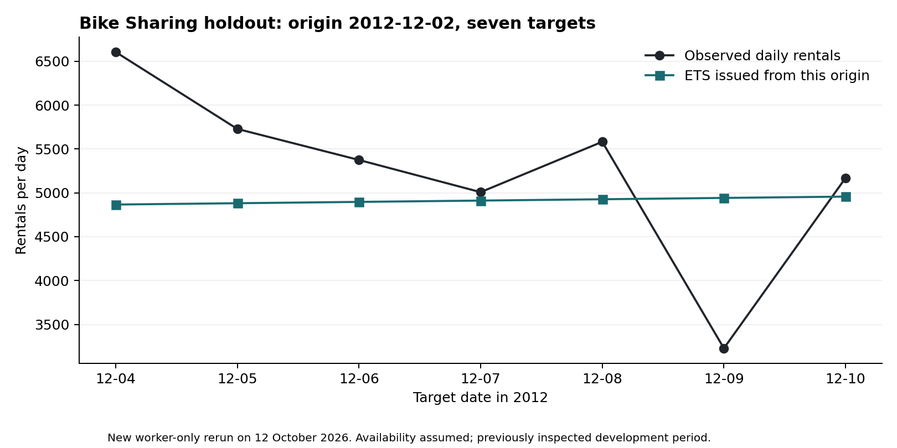

# Evaluation results

## Settings and metrics

Weekly defaults are a four-week forecast horizon, one-week gap, eight held-out weeks and 12 rolling origins. Daily defaults are seven forecast days, one gap day, 28 held-out days and 12 origins. Validation origins are one period apart, so their target windows overlap. They are not independent observations.

Candidates are naive, seasonal naive, nonseasonal AutoETS and fixed-parameter LightGBM lag features. Comparison uses the intersection of series, origins and targets available for every candidate. Imputed targets and recorded stockout periods are excluded from the main score.

The candidate selection threshold is 5% below seasonal naive when that model can run, otherwise naive. It does not always compare against the best baseline. When no candidate qualifies, the best baseline stays. The model choice is written before the held-out forecasts are computed.

MAE is mean absolute error. Bias is mean forecast minus actual. MASE divides each absolute error by its series' mean absolute first differences. This is lag-1 scaling, not seasonal scaling. The denominator is calculated from the pre-holdout segment and shared across validation origins; later pre-holdout values therefore affect earlier score scaling. MASE below one does not necessarily mean a model beat the evaluated naive forecast.

## Datasets

Retail uses net product units per week: sales less cancellation quantities in the cancellation week. Product selection uses sales before the first evaluation origin. Exact duplicate transaction lines are removed. Empty weeks after first sale count as zero. The source does not provide publication timestamps; availability is assumed at the end of each week. [Manifest](../evaluation/recorded/public-data/manifest-uci-retail-v2.json).

Bike Sharing uses daily total rentals for 731 gap-free days in 2011–2012. Same-day components and observed weather are excluded. Availability is assumed at next-day 06:00 UTC. [Manifest](../examples/bike-sharing/manifest.json).

SMARD uses daily German electricity grid load. The included recorded run ends 27 September 2026 and assumes next-day publication. The source data may be revised; this record does not reconstruct earlier vintages. [Stored report](../evaluation/recorded/public-data/smard-2026-09-28/evaluation_report.json).

## What was reproduced

The Bike Sharing ZIP checksum and prepared daily CSV matched the recorded manifests. The worker run on 12 October 2026 reproduced the validation scores, final-period scores and frozen-selection hash. ETS final-period MASE was 1.8529; naive was better at 1.7484. Retail and SMARD scores were inspected but not rerun for this public release.

This chart uses the first seven-target ETS window from the new worker run, from origin 2 December 2012. It does not illustrate the entire held-out period or imply forecast superiority.

## Prediction intervals

Both stored interval studies conclude NOT validated. For nominal 80% intervals, pooled_w10 covered 58.04% on the bike test and 87.95% on the second study's SMARD-area test. Planning ignores these ranges. The [study records](forecast/evidence/) include development results, fixed selection rules and failures.

## What the planning example establishes

The synthetic example verifies that the worker can produce forecasts and point replenishment proposals. The policy accounts for confirmed receipts, shortages over the protection window, pack sizes and minimum orders. It is a stated test policy, not an optimal inventory policy. No realized cost saving or revenue gain is established by that example.
